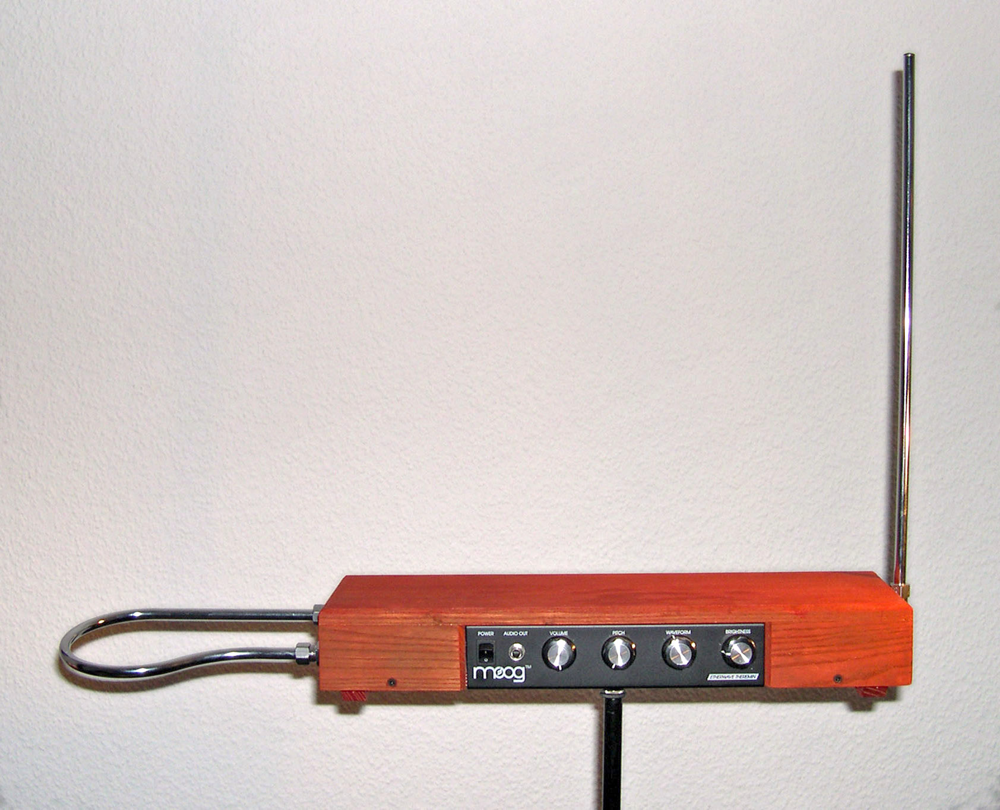
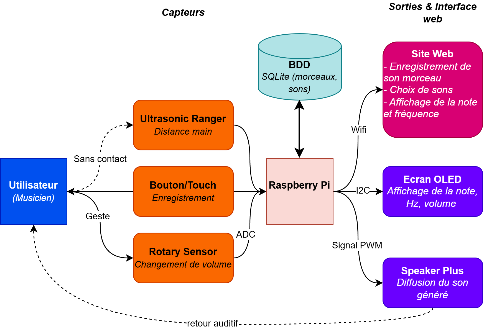

# raspberry_theremine

**UE :** LU1IN021 — Automne 2026  
**Groupe :** Uruththiran, Philémon, Anès  

---

### 4.1 - Introduction :

Le projet consiste à concevoir et réaliser un thérémine numérique connecté à l’aide d’un Raspberry Pi et de capteurs Grove.

Le thérémine est un instrument de musique électronique qui a la particularité de se jouer sans aucun contact physique : la position des mains dans l'air modifie la hauteur de la note et le volume sonore.

Il est l’un des plus anciens instruments de musique électronique et a été inventé par Léon Thérémine en 1920.

L’objectif du projet est à la fois artistique et ludique :
* Il permet à n’importe qui de produire de la musique par des gestes dans l’air
* Il facilite l’utilisation grâce à différents modes (mode continu traditionnel ou mode ajusté sur des gammes justes)

Nous avons eu l’idée de cet instrument car l’un d’entre nous possède un véritable thérémine et le TD d’introduction au Raspberry Pi sur l’émission de diverses fréquences grâce à un buzzer ainsi que les capteurs de distance nous a permis de nous accorder sur le fait que le thérémine semblait être une bonne idée.

---

### 4.2 - Schéma du projet :

*Schéma fait avec draw.io*

---

### 4.3 - Scénarios d'usages :

#### Scénario 1 (Jouer de la musique en temps réel)
* L’utilisateur place sa main droite au-dessus du capteur ultrason et règle le volume avec le potentiomètre (rotary angle sensor) grâce à sa main gauche. En boucle continue, le Raspberry lit ces valeurs et va convertir la distance en fréquence ce qui va émettre le son sur le Speaker Plus. La note sera ensuite affichée sur l’écran OLED. Si la main sort de la zone de détection, le son s’arrêtera automatiquement.

#### Scénario 2 (Enregistrement des données captées)
* L’utilisateur peut déclencher un enregistrement (grâce à un bouton physique ou un bouton sur le site internet) pour sauvegarder la mélodie qu’il a jouée. Le Raspberry Pi va capturer en continu les notes, leur durée et leur volume pour pouvoir reproduire à l’identique le son que l’utilisateur a enregistré. C’est une fonctionnalité de composition.

#### Scénario 3 (Gestion des sons sur le site web)
* L’utilisateur se connecte au site web via Wi-Fi, il peut observer en temps réel la note et la fréquence produite par le thérémine (la même chose que sur l’écran OLED), consulter les morceaux stockés en base de données et sélectionner des sons prédéfinis qui pourront permettre de changer le type de son du thérémine (son de violon, son de trompette etc…).

#### Scénario 4 (Lecture de morceaux)
* Toujours sur le site web, l’utilisateur pourra choisir un morceau stocké dans la base de données (morceaux préenregistrés ou composition enregistrée grâce à la fonctionnalité précédente) et le thérémine jouera tout seul l’enregistrement choisi.

---

### 4.4 - Description des fonctionnalités :

| N° | Nom | Description | Sur quoi la fonction agit | Importance |
|:---|:---|:---|:---|:---:|
| 1 | Lire les capteurs | Le Raspberry lit en continu la distance de la main, le niveau de volume et l’état des boutons. | Raspberry, capteur ultrason, Potentiomètre, bouton/touch | 1 |
| 2 | Calculer et produire le son | Le Raspberry convertit la distance en fréquence selon le son choisi et l’hautparleur émet le son | Raspberry, Speaker Plus, base de données (presets) | 1 |
| 3 | Afficher les infos sur l’écran | Le Raspberry affiche les données (note, fréquence, volume) sur l'écran | Raspberry Pi, écran OLED | 2 |
| 4 | Enregistrer d’un morceau | Le Raspberry capture la suite de notes, les durées de chaque note et le volume puis enregistre le tout dans la base de données | Raspberry, capteur ultrason, bouton, BDD | 2 |
| 5 | Sélectionner un type de son | L’utilisateur choisit un profil sonore (continu, gamme, vibrato) ou son d’instruments (violon, trompette) | Raspberry, Speaker plus, Site Web | 3 |
| 6 | Gérer les presets et morceaux | L’utilisateur peut modifier ou supprimer les presets et les morceaux depuis le site web | BDD, Site Web | 3 |

---

### 4.5 Planning prévisionnel

| Membre / Rôle                     | Semaine 1                  | Semaine 2 | Semaine 3 | Semaine 4          |
| :-------------------------------- | :------------------------- | :-------- | :-------- | :----------------- |
| **Philémon** Audio et Capteurs | F1                         | F2        | F4        | Tests & Soutenance |
| **Uruththiran** BDD & OLED     | Création BDD (SQLite)      | F3        | F4, F6    | Tests & Soutenance |
| **Anès** Site Web              | Structure Site Web (Flask) | F5        | F6        | Tests & Soutenance |
